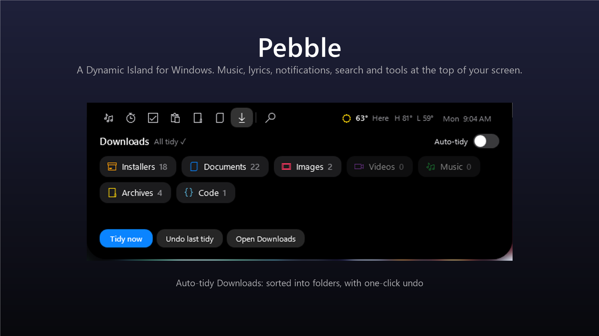

# Pebble Island

A Dynamic Island for Windows. Pebble lives in a small pill at the top of your screen: hover over it to open music controls, lyrics, notifications, timers and more.

**Get it on the Microsoft Store:** search for "Pebble Island", or open the Store link from the app's product page.



## Features

- **Now playing:** album art, progress and controls for Spotify, YouTube, Media Player and more
- **Synced lyrics** in the island (from [LRCLIB](https://lrclib.net))
- **Notifications** slide into the island, with a history tab
- **Game mode:** FPS and ping in the pill, and notifications held until you're done playing
- **Search** (Alt+Space): apps, settings, recent files, quick math and web search
- **Tools:** Pomodoro timer, to-do list, clipboard history, file shelf, teleprompter, color picker (Ctrl+Alt+C)
- **Auto-tidy Downloads** with one-click undo
- Weather, battery and Bluetooth alerts, volume pop-ups
- Settings for everything, including open/close delay and showing over fullscreen apps

## Build it yourself

Requirements: Windows 10 (19041) or later and the [.NET 8 SDK](https://dotnet.microsoft.com/download/dotnet/8.0).

```powershell
dotnet build -c Release
# run: bin\Release\net8.0-windows10.0.19041.0\Pebble.exe
```

Note: on PCs with **Smart App Control** turned on, Windows blocks unsigned builds you compile yourself. The Microsoft Store version is signed and runs normally.

### Make the Store package (MSIX)

1. Download the Windows SDK build tools into `tools\sdk-buildtools\pkg` (the NuGet package `Microsoft.Windows.SDK.BuildTools`, extracted).
2. Regenerate icons if needed: `powershell -File tools\make-icons.ps1`
3. Build the package: `powershell -File tools\package.ps1`

The package lands in `artifacts\`.

## Project layout

| Path | What's there |
|---|---|
| `MainWindow.xaml(.cs)` | The island: layout, animations, tabs and features |
| `LauncherWindow.xaml(.cs)` | The search pill (Alt+Space) |
| `SettingsWindow`, `TourWindow`, `ColorPickerWindow` | Settings page, welcome tour, color picker |
| `Services/` | Media, weather, lyrics, notifications, game mode, downloads tidy, settings |
| `Assets/` | App icon and Store logos |
| `store/` | Store listing text, privacy policy and screenshot |
| `tools/` | Icon and packaging scripts |

## Privacy

No accounts, ads or tracking. Settings and to-dos stay on your PC, and clipboard and notification history are kept in memory only. See [store/privacy-policy.html](store/privacy-policy.html).
